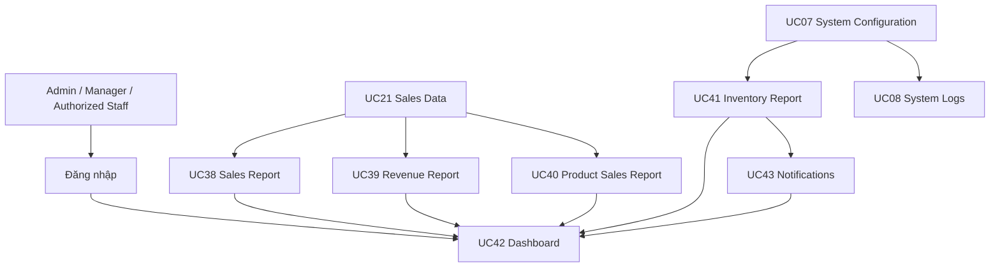

# Phạm vi nghiệp vụ của Thắng

Tài liệu này mô tả phần nghiệp vụ và phần triển khai do **Thắng** phụ trách trong dự án **Supermarket Management System (SMS)**. Mục đích là giúp các thành viên trong nhóm hiểu nhanh phạm vi, luồng dữ liệu, điểm tích hợp và vị trí source code liên quan.

## 1. Tổng quan phạm vi

Phần của Thắng gồm 9 use case, tập trung vào theo dõi vận hành và hỗ trợ ra quyết định:

| Nhóm | Use case | Tên nghiệp vụ | Actor chính |
|---|---|---|---|
| System Management | UC07 | Manage System Configuration | Admin |
| System Management | UC08 | View System Logs | Admin |
| Sales Monitoring | UC21 | View Sales | Admin, Manager |
| Reporting | UC38 | View Sales Report | Admin, Manager |
| Reporting | UC39 | View Revenue Report | Admin, Manager |
| Reporting | UC40 | View Product Sales Report | Admin, Manager |
| Reporting | UC41 | View Inventory Report | Admin, Manager, Inventory Staff |
| Dashboard | UC42 | View Dashboard | Admin, Manager |
| Notification | UC43 | View Notifications | Người dùng được nhận thông báo |

Tóm tắt trách nhiệm:

> Quản lý cấu hình và audit log; theo dõi giao dịch bán hàng; tổng hợp dữ liệu bán hàng và tồn kho thành báo cáo; hiển thị KPI trên Dashboard; cung cấp thông báo cho các sự kiện cần chú ý.

## 2. Luồng nghiệp vụ tổng hợp

Luồng dữ liệu chính:

1. UC07 cung cấp các tham số vận hành như ngưỡng tồn kho thấp hoặc số ngày cảnh báo gần hết hạn.
2. UC21 theo dõi dữ liệu giao dịch bán hàng.
3. UC38, UC39 và UC40 tổng hợp dữ liệu từ các giao dịch đã hoàn tất.
4. UC41 phân tích tình trạng tồn kho dựa trên dữ liệu sản phẩm, lô hàng và cấu hình hệ thống.
5. UC43 đưa các sự kiện quan trọng đến đúng người dùng.
6. UC42 tổng hợp các KPI quan trọng để Admin/Manager theo dõi nhanh tình hình siêu thị.
7. UC08 lưu và cho phép Admin kiểm tra lịch sử các hành động quản trị.

## 3. Chi tiết từng use case

### UC07 – Manage System Configuration

**Mục tiêu:** Cho phép Admin thay đổi các tham số vận hành mà không cần sửa source code.

Luồng chính:

1. Admin mở trang System Settings.
2. Hệ thống tải các cấu hình hiện tại.
3. Admin sửa giá trị và chọn **Save Changes**.
4. Hệ thống kiểm tra kiểu dữ liệu và giới hạn nghiệp vụ.
5. Nếu hợp lệ, hệ thống cập nhật giá trị, người cập nhật và thời gian cập nhật.
6. Hệ thống ghi audit log và thông báo thành công.

Ví dụ cấu hình:

- `NEAR_EXPIRY_WARNING_DAYS`
- `LOW_STOCK_THRESHOLD`
- `STORE_NAME`
- `SESSION_TIMEOUT`

Lưu ý: cấu hình `MAX_FAILED_LOGIN_ATTEMPTS` không còn được sử dụng vì UC01 hiện không tự khóa tài khoản khi nhập sai mật khẩu.

### UC08 – View System Logs

**Mục tiêu:** Cung cấp khả năng audit, monitoring và traceability cho Admin.

Admin có thể:

- Tìm kiếm theo người dùng hoặc nội dung hành động.
- Lọc theo action, entity type và khoảng thời gian.
- Phân trang, sắp xếp và xem chi tiết log.

UC08 là use case chỉ đọc; người dùng không được sửa hoặc xóa audit log tại màn hình này.

### UC21 – View Sales

**Mục tiêu:** Theo dõi toàn bộ giao dịch bán hàng của siêu thị.

Thông tin chính:

- Mã giao dịch/hóa đơn.
- Thời gian.
- Thu ngân.
- Số mặt hàng.
- Tổng tiền.
- Trạng thái giao dịch.

Bộ lọc hỗ trợ tìm kiếm theo mã giao dịch, trạng thái và khoảng thời gian. Người dùng có thể mở chi tiết giao dịch/hóa đơn từ danh sách.

Các trạng thái nghiệp vụ gồm giao dịch đang xử lý, hoàn tất và đã hủy. Chỉ giao dịch hoàn tất được dùng để tính doanh thu trong các báo cáo.

### UC38 – View Sales Report

**Mục tiêu:** Phân tích hoạt động bán hàng trong một khoảng thời gian.

Luồng chính:

1. Người dùng chọn `From Date` và `To Date`.
2. Hệ thống kiểm tra khoảng ngày.
3. Hệ thống lấy các giao dịch hoàn tất.
4. Hệ thống tính tổng doanh số, số giao dịch, giảm giá và doanh số thuần.
5. Kết quả được trình bày bằng KPI, biểu đồ và bảng theo ngày.

### UC39 – View Revenue Report

**Mục tiêu:** Tổng hợp doanh thu thực tế từ các giao dịch hoàn tất.

Kết quả gồm:

- Tổng doanh thu.
- Doanh thu tiền mặt.
- Doanh thu thẻ.
- Doanh thu ví điện tử.
- Doanh thu từ phương thức khác.
- Xu hướng doanh thu theo ngày.

UC39 là **Revenue Report**, không phải Profit Report; hệ thống không trừ chi phí để tính lợi nhuận.

### UC40 – View Product Sales Report

**Mục tiêu:** Xác định sản phẩm và ngành hàng bán tốt trong một khoảng thời gian.

Người dùng có thể lọc theo:

- Khoảng ngày.
- Danh mục sản phẩm.
- Kiểu xếp hạng: số lượng hoặc doanh thu.

Kết quả gồm số lượng bán, doanh thu sản phẩm, tỷ trọng doanh thu và danh sách sản phẩm bán chạy. Báo cáo hỗ trợ quyết định nhập hàng và xây dựng khuyến mãi.

### UC41 – View Inventory Report

**Mục tiêu:** Theo dõi sức khỏe tồn kho của siêu thị.

KPI chính:

- Tổng số sản phẩm.
- Sản phẩm còn hàng.
- Sản phẩm sắp hết hàng.
- Sản phẩm hết hàng.
- Hàng gần hết hạn.

Người dùng có thể lọc theo danh mục và trạng thái tồn kho. Việc phân loại `LOW STOCK` sử dụng ngưỡng cấu hình từ UC07.

### UC42 – View Dashboard

**Mục tiêu:** Cung cấp màn hình tổng hợp cho Admin/Manager; Dashboard không tạo dữ liệu nghiệp vụ mới.

Dashboard tổng hợp:

- Doanh số hôm nay.
- Doanh thu trong tháng.
- Số sản phẩm đang hoạt động.
- Tình trạng tồn kho.
- Xu hướng bán hàng.
- Sản phẩm bán chạy.
- Cảnh báo tồn kho.

UC42 phụ thuộc dữ liệu từ UC21 và các báo cáo UC38–UC41.

### UC43 – View Notifications

**Mục tiêu:** Đưa sự kiện quan trọng đến đúng người dùng.

Nguồn thông báo có thể gồm:

- Tồn kho thấp.
- Hàng gần hết hạn.
- Thay đổi đơn đặt hàng.
- Sự kiện hệ thống.

Luồng chính:

1. Một business event xảy ra.
2. Notification Service tạo thông báo và gắn người nhận.
3. Hệ thống hiển thị số thông báo chưa đọc.
4. Người dùng mở danh sách thông báo.
5. Người dùng đánh dấu thông báo đã đọc và có thể mở màn hình liên quan.

## 4. Scenario liên kết 9 UC

1. Admin đặt `LOW_STOCK_THRESHOLD = 15` trong UC07.
2. Việc thay đổi cấu hình được ghi lại trong UC08.
3. Cashier hoàn tất một giao dịch bán hàng.
4. Giao dịch xuất hiện trong UC21.
5. Dữ liệu giao dịch được tổng hợp trong UC38, UC39 và UC40.
6. Việc bán hàng làm tồn kho một sản phẩm giảm từ 20 xuống 12.
7. UC41 xác định `12 < 15` và đánh dấu sản phẩm là `LOW STOCK`.
8. UC43 tạo thông báo tồn kho thấp cho người dùng phù hợp.
9. UC42 hiển thị doanh số, doanh thu, sản phẩm bán chạy và cảnh báo tồn kho trên Dashboard.

## 5. Mapping với source code

### Frontend

| UC | Route | Page chính | Service |
|---|---|---|---|
| UC07 | `/system-settings` | `pages/system/SystemSettingsPage.jsx` | `services/systemSettingService.js` |
| UC08 | `/system-logs` | `pages/system/SystemLogsPage.jsx` | `services/systemLogService.js` |
| UC21 | `/sales` | `pages/sales/SaleListPage.jsx` | `services/saleService.js` |
| UC38 | `/reports/sales` | `pages/reports/SalesReportPage.jsx` | `services/salesReportService.js` |
| UC39 | `/reports/revenue` | `pages/reports/RevenueReportPage.jsx` | `services/reportService.js` |
| UC40 | `/reports/product-sales` | `pages/reports/ProductSalesReportPage.jsx` | `services/reportService.js` |
| UC41 | `/reports/inventory` | `pages/reports/InventoryReportPage.jsx` | `services/reportService.js` |
| UC42 | `/` | `pages/HomePage.jsx` | `services/dashboardService.js` |
| UC43 | `/notifications` | `pages/notifications/NotificationsPage.jsx` | `services/notificationService.js` |

### Backend API

| UC | API chính | Controller | Service |
|---|---|---|---|
| UC07 | `/api/v1/system-settings` | `SystemSettingController` | `SystemSettingService` |
| UC08 | `/api/v1/system-logs` | `SystemLogController` | `SystemLogService` |
| UC21 | `/api/v1/sales` | `SaleController` | `SaleService` |
| UC38 | `/api/v1/reports/sales` | `SalesReportController` | `SalesReportService` |
| UC39 | `/api/v1/reports/revenue` | `ReportController` | `ReportService` |
| UC40 | `/api/v1/reports/product-sales` | `ReportController` | `ReportService` |
| UC41 | `/api/v1/reports/inventory` | `ReportController` | `ReportService` |
| UC42 | `/api/v1/dashboard` | `DashboardController` | `DashboardService` |
| UC43 | `/api/v1/notifications` | `NotificationController` | `NotificationService` |

## 6. Phụ thuộc và quy ước tích hợp

- Báo cáo doanh thu/bán hàng chỉ sử dụng giao dịch có trạng thái hoàn tất.
- Báo cáo tồn kho phụ thuộc dữ liệu sản phẩm, phiếu nhập, biến động kho và cấu hình ngưỡng.
- Dashboard chỉ tổng hợp dữ liệu; không nên sao chép logic tính toán khác nhau giữa Dashboard và Report.
- Notification phải gắn đúng người nhận; Supplier không được xem thông báo hoặc đơn hàng của Supplier khác.
- System Settings và System Logs chỉ dành cho Admin.
- Các API phải trả về cấu trúc `ApiResponse` dùng chung và frontend hiển thị lỗi từ backend.
- Thay đổi công thức KPI hoặc định nghĩa trạng thái cần được cập nhật đồng thời ở service, DTO, UI và tài liệu này.

## 7. Phân công khi phối hợp

Khi một thành viên thay đổi module liên quan, cần báo cho Thắng nếu thay đổi ảnh hưởng tới:

- Trạng thái hoặc cấu trúc của `Sale`, `Payment`, `Product`, tồn kho hoặc Notification.
- Công thức tính doanh số, doanh thu, giảm giá hoặc số lượng tồn.
- Cấu hình ngưỡng tồn kho/cảnh báo gần hết hạn.
- Quyền truy cập của Admin, Manager, Inventory Staff hoặc Supplier.
- DTO/API đang được các trang report và Dashboard sử dụng.

## 8. Cách trình bày ngắn gọn

Nếu cần giới thiệu phần phụ trách:

> Phần của Thắng tập trung vào monitoring và decision support cho siêu thị. Phạm vi gồm cấu hình hệ thống và audit log, theo dõi giao dịch bán hàng, các báo cáo sales/revenue/product/inventory, Dashboard tổng hợp KPI và Notification cho các sự kiện cần chú ý như tồn kho thấp hoặc gần hết hạn.
